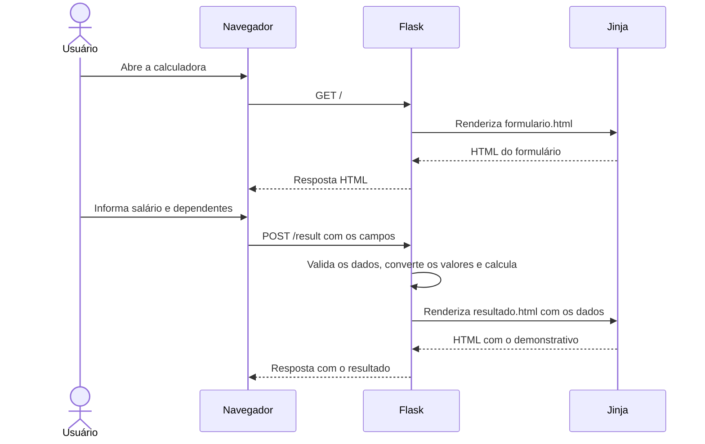

# Conta clara — Calculadora de salário com Flask

Aplicação de estudo que recebe um salário bruto e a quantidade de dependentes, calcula descontos e um bônus e apresenta o salário líquido em uma página HTML.

O foco do projeto é praticar o fluxo de uma aplicação web com **Flask**: criar rotas, receber dados por **POST**, processá-los no servidor e renderizar o resultado com **Jinja**.

Os percentuais são regras simplificadas do exercício. A aplicação não implementa uma folha de pagamento nem as tabelas oficiais de INSS e imposto de renda.

## Funcionalidades

- Formulário para informar o salário bruto mensal e o número de dependentes.
- Validação no servidor de campos obrigatórios, tipos numéricos, valores negativos, salário finito e limite de 10 dependentes.
- Cálculo do salário líquido com demonstrativo dos descontos e do bônus.
- Valores apresentados em reais, com separador de milhares e duas casas decimais.
- Interface responsiva, rótulos nos campos e indicação de foco para navegação por teclado.
- Retorno ao formulário para fazer outro cálculo.
- Testes automatizados das rotas, dos resultados e dos arquivos estáticos.

## Stack utilizada

| Tecnologia | Papel no projeto |
| --- | --- |
| Python | Conversão dos dados e regras de cálculo |
| Flask 3.1.3 | Rotas HTTP, leitura do formulário e respostas HTML |
| Jinja | Templates, condicionais e formatação dos valores |
| HTML5 | Estrutura das páginas e validação dos campos no navegador |
| CSS3 | Layout responsivo, cores, tipografia e estados de interação |
| unittest | Execução dos testes, usando a biblioteca padrão do Python |
| Cliente de testes do Flask | Requisições à aplicação sem iniciar um servidor |

O ambiente local usa Python 3.14.7 e Jinja 3.1.6. O Flask está fixado em `requirements.txt`; suas dependências, incluindo Jinja e Werkzeug, são instaladas automaticamente pelo pip. Veja a [documentação de instalação do Flask](https://flask.palletsprojects.com/en/stable/installation/).

As fontes DM Sans e Libre Caslon Display são servidas localmente. Suas licenças estão na pasta `static/fonts`.

## Processo dos dados



1. A rota `GET /` chama `render_template` para apresentar o formulário.
2. O formulário envia os campos `salary` e `dependentsNumber` para `POST /result`.
3. A função da rota lê os campos com `request.form.get`, remove espaços nas extremidades e verifica o preenchimento. Em seguida, converte o salário para `float` e a quantidade de dependentes para `int`, tratando falhas de conversão.
4. O servidor rejeita salários não finitos ou negativos e quantidades de dependentes fora do intervalo de 0 a 10. Com dados válidos, calcula INSS, imposto, bônus e salário líquido. Entradas inválidas encerram o fluxo com uma mensagem específica e status 400.
5. `render_template` passa os valores como variáveis do contexto de `resultado.html`.
6. O Jinja monta o HTML e formata os valores para exibição. O navegador recebe a página pronta e carrega CSS e fontes pela rota de arquivos estáticos.

Os dados são processados na requisição. A aplicação não usa banco de dados, autenticação ou histórico de cálculos.

### Rotas

| Método | Caminho | Comportamento |
| --- | --- | --- |
| GET | `/` | Exibe o formulário |
| POST | `/result` | Recebe os campos e exibe o resultado |
| GET | `/static/<arquivo>` | Serve CSS e fontes |

Abrir `/result` diretamente pela barra de endereço envia um `GET`, que retorna **405 — Method Not Allowed**. Para ver um resultado, envie o formulário.

### Validações no servidor

| Entrada | Tratamento |
| --- | --- |
| Campo ausente, vazio ou contendo apenas espaços | Mensagem solicitando o preenchimento e status 400 |
| Salário não numérico | Mensagem de número inválido e status 400 |
| Salário `NaN`, infinito ou valor como `1e999` | Mensagem de número não finito e status 400 |
| Salário negativo | Mensagem específica e status 400 |
| Dependentes não inteiros ou negativos | Mensagem específica e status 400 |
| Mais de 10 dependentes | Mensagem de limite permitido e status 400 |
| Salário zero e quantidade de dependentes entre 0 e 10, inclusive | Valores aceitos |

As verificações são executadas antes do cálculo, mesmo em requisições enviadas diretamente ao servidor. As mensagens de erro são respostas textuais; o formulário ainda não é reapresentado com os dados preenchidos.

## Regras do cálculo

| Item | Regra implementada |
| --- | --- |
| INSS | 8% do salário bruto |
| Imposto | 15% do salário bruto, somente quando ele é maior que R$ 2.500,00 |
| Bônus | R$ 200,00 por dependente |
| Salário líquido | Salário bruto − INSS − imposto + bônus |

Em R$ 2.500,00 exatos, o imposto é zero. Acima desse limite, os 15% incidem sobre o salário inteiro, conforme a regra do exercício.

**Exemplo:** para R$ 3.000,00 e dois dependentes:

```text
Salário bruto      R$ 3.000,00
INSS             − R$   240,00
Imposto          − R$   450,00
Bônus            + R$   400,00
Salário líquido    R$ 2.710,00
```

## Estrutura do projeto

```text
flask/
├── app.py                    # Aplicação, rotas e cálculos
├── requirements.txt          # Dependência direta
├── README.md
├── templates/
│   ├── formulario.html       # Página de entrada
│   └── resultado.html        # Demonstrativo e formatação
├── static/
│   ├── formulario.css        # Base visual e estilos do formulário
│   ├── resultado.css         # Estilos específicos do resultado
│   └── fonts/                # Fontes locais e suas licenças
└── tests/
    └── test_app.py            # Testes HTTP e dos valores exibidos
```

## Como executar

Instale o Python e abra um terminal na pasta que contém `app.py`. Os comandos abaixo criam um ambiente virtual para as dependências do projeto. Se a pasta `.venv` já existir e estiver funcionando, pule sua criação.

### Windows — PowerShell

```powershell
py -3 -m venv .venv
.\.venv\Scripts\python.exe -m pip install -r requirements.txt
.\.venv\Scripts\python.exe -m flask --app app run --debug
```

Os comandos usam diretamente o Python do ambiente virtual; não é necessário ativá-lo nem alterar a política de execução do PowerShell.

### Linux ou macOS

```bash
python3 -m venv .venv
.venv/bin/python -m pip install -r requirements.txt
.venv/bin/python -m flask --app app run --debug
```

Acesse [http://127.0.0.1:5000](http://127.0.0.1:5000) e preencha o formulário. Para encerrar o servidor, pressione `Ctrl+C` no terminal.

Se a porta estiver ocupada, acrescente `--port 5055` ao comando e acesse [http://127.0.0.1:5055](http://127.0.0.1:5055).

O modo `--debug` ajuda durante o desenvolvimento, com recarga após alterações. O servidor embutido deve ser usado localmente para desenvolvimento, conforme a [documentação do servidor Flask](https://flask.palletsprojects.com/en/stable/server/).

## Testes

Os testes usam `unittest` e o cliente de testes do Flask. Não é necessário instalar pytest, iniciar o servidor ou abrir o navegador. As requisições percorrem as rotas reais e verificam as respostas HTML, conforme o recurso descrito em [Testing Flask Applications](https://flask.palletsprojects.com/en/stable/testing/#sending-requests-with-the-test-client).

Na pasta do projeto, execute:

**Windows:**

```powershell
.\.venv\Scripts\python.exe -m unittest discover -s tests -v
```

**Linux ou macOS:**

```bash
.venv/bin/python -m unittest discover -s tests -v
```

### O que é verificado

- Resposta da página inicial e formulário com destino e campos corretos.
- Valores de cada linha do demonstrativo, incluindo formatação em reais.
- Salário zero, valores decimais e diferentes quantidades de dependentes, incluindo o limite de 10.
- Valores válidos com espaços nas extremidades.
- Limite de R$ 2.500,00 e valor imediatamente acima dele.
- Mensagens específicas e status 400 para entradas que não podem ser convertidas em números válidos para os campos.
- Mensagens específicas e status 400 para campos ausentes, vazios ou contendo apenas espaços.
- Rejeição de valores negativos e salários não finitos (`NaN`, infinitos e `1e999`).
- Rejeição de 11 dependentes e de uma quantidade com 309 dígitos, que antes causava erro durante o cálculo.
- Resposta 405 ao acessar o resultado com GET.
- Disponibilidade dos dois arquivos CSS e das três fontes locais.

| Salário enviado | Dependentes | Líquido esperado |
| --- | --- | --- |
| 0 | 0 | R$ 0,00 |
| 2000 | 0 | R$ 1.840,00 |
| 2500 | 1 | R$ 2.500,00 |
| 2500.01 | 0 | R$ 1.925,01 |
| 3000 | 2 | R$ 2.710,00 |
| 3000 | 10 | R$ 4.310,00 |
| 1234.56 | 2 | R$ 1.535,80 |

Os valores esperados são explícitos: os testes não recalculam o resultado usando a mesma fórmula do código. Também não dependem das cores ou das classes CSS da interface.

### Conferência manual da interface

1. Abra a página e tente enviar o formulário sem salário: o navegador deve solicitar o preenchimento.
2. Informe salário de 3000 e dois dependentes: o resultado deve ser R$ 2.710,00.
3. Clique em **Fazer novo cálculo** e confirme o retorno ao formulário.
4. Repita com salário zero: a página deve apresentar o demonstrativo com R$ 0,00.
5. Confira a interface no celular e navegue pelos campos com `Tab` no computador.

Os testes HTTP não verificam aparência, responsividade ou validação nativa do navegador; essa conferência é separada.

## Decisões de implementação

- Renderização no servidor: Flask e Jinja entregam HTML pronto, sem JavaScript para o fluxo de cálculo.
- Cálculos no Python e formatação no template, separando processamento e apresentação.
- CSS do formulário compartilhado como base visual; o resultado acrescenta seu próprio arquivo de estilos.
- Uso de `url_for` para gerar os endereços das rotas e dos arquivos estáticos.
- Testes na fronteira HTTP, exercitando entrada, cálculo e saída sem introduzir uma nova arquitetura.

## Limites atuais e próximos passos

- Entradas inválidas já recebem mensagens específicas e status 400. Uma melhoria é reapresentar o formulário, preservar os dados informados e mostrar a mensagem junto ao campo.
- O servidor limita os dependentes a 10; o campo HTML ainda não indica esse máximo. Alinhar essa indicação melhora a experiência de preenchimento.
- O salário ainda não tem um limite máximo de valor nem uma validação de até duas casas decimais na entrada. Valores finitos muito grandes e valores com mais casas decimais continuam sendo aceitos.
- O salário usa `float`. Uma evolução para cálculos monetários mais rigorosos é adotar `Decimal` e definir explicitamente a regra de arredondamento.
- O processamento espera ponto decimal nos dados recebidos. A formatação com vírgula ocorre na saída; não há um interpretador de texto monetário brasileiro no backend.
- Autenticação, persistência, publicação em produção e cálculo tributário oficial estão fora do escopo atual.

## Conceitos praticados

Rotas e métodos HTTP, leitura de `request.form`, conversão de tipos, condicionais, tratamento básico de exceções, contexto de templates, filtros e macros Jinja, arquivos estáticos e testes de integração HTTP.

A interface foi estilizada com assistência de IA. O projeto pode ser apresentado como exercício prático de Flask, com suas regras e limitações descritas acima.
